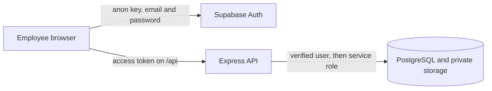
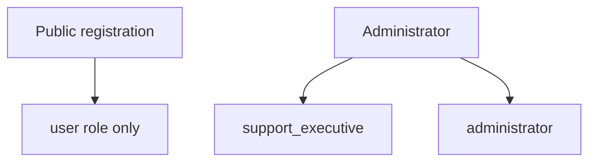
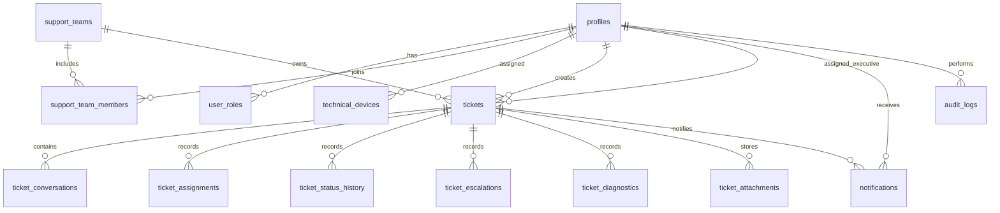

# AI-Powered IT Service Desk and Technical Incident Management Platform

A college project for reporting technical incidents, guiding safe troubleshooting, creating support tickets, and connecting people with the right IT team.

**Current phase: 2 — ticket management.** Sign-in, roles, manual ticket creation, ticket numbers, lists, details, and status history are in the repository. The support assistant, automatic choice of a support person, live chat, and charts are not built yet. The application does not call a language model.

## What works in this phase

- React sign-in and registration.
- A profile stored for each account, including employee ID, department, and job title.
- Three roles: `user`, `support_executive`, and `administrator`.
- Public registration always creates a normal user. It cannot grant support or administrator access.
- An administrator page to grant or remove those roles and to activate or deactivate accounts.
- Express checks the Supabase access token and ignores any user id sent in the request body.
- Manual ticket creation, database ticket numbers, ticket lists, ticket details, and status history.
- A new ticket is placed in a category queue. A specific support person is not chosen yet.
- PostgreSQL tables, ticket numbering, Row Level Security, and a private attachment bucket are written as SQL migrations.
- Classroom sample data: support teams, SLA targets, knowledge articles, and a seed script for people, devices, and incidents.

## What is not built yet

- The support assistant and Ollama.
- Choosing a specific support person, escalation workflow, and live chat.
- Dashboards and charts. Recharts is installed for a later phase and is not used yet.
- A live check that the Row Level Security policies behave correctly in your Supabase project. The policies are written. They start protecting data only after you run the SQL files.

The home page says the assistant is **not enabled**. That is intentional. This phase must not look like an AI model is answering.

## Project layout

```text
client/     React, Vite, Tailwind, JavaScript
server/     Express API, JavaScript
supabase/   SQL migrations and reference data
```

The browser talks to Supabase Auth with the public anon key. All other account changes go through Express. Express verifies the access token, then uses the service-role key. That key bypasses Row Level Security, so the API repeats the permission check before it changes anything.



## Prerequisites

- Node.js 20 or newer. This project was prepared with Node.js 26.
- A free [Supabase](https://supabase.com) project.
- npm.

Do not install Ollama yet. Leave `OLLAMA_MODEL` empty. A later phase will add the local model, and only after you choose one that fits your computer.

## 1. Create the Supabase project

1. Create a project on the free plan.
2. Open **Project Settings → API**.
3. Copy the project URL, the `anon` key, and the `service_role` key.
4. Open **Authentication → Providers** and keep Email enabled.
5. For a classroom demo, open **Authentication → Sign In / Providers** and turn off **Confirm email**. If you leave it on, new registrations must open the confirmation email before they can sign in. The seed script marks the demo accounts confirmed either way.

## 2. Run the database scripts

In the Supabase **SQL Editor**, run these files in order. Paste the whole file, run it, then go to the next one.

1. `supabase/migrations/202610130001_foundation_schema.sql`
2. `supabase/migrations/202610130002_rls_and_auth.sql`
3. `supabase/migrations/202610130003_reference_data.sql`

The third file loads support teams, response-time targets, and published troubleshooting articles. It also loads one draft article that normal users must not be able to read.

Confirm the private bucket `ticket-attachments` exists under **Storage**. The second script creates it. Nothing is public in that bucket.

## 3. Configure environment files

Create two files. Do not commit them.

`client/.env` from `client/.env.example`:

```text
VITE_SUPABASE_URL=https://your-project.supabase.co
VITE_SUPABASE_ANON_KEY=your-anon-key
VITE_API_URL=
```

`server/.env` from `server/.env.example`:

```text
PORT=4000
CLIENT_ORIGIN=http://localhost:5173
SUPABASE_URL=https://your-project.supabase.co
SUPABASE_ANON_KEY=your-anon-key
SUPABASE_SERVICE_ROLE_KEY=your-service-role-key
AI_PROVIDER=rules
OLLAMA_BASE_URL=http://127.0.0.1:11434
OLLAMA_MODEL=
SEED_DEMO_PASSWORD="CampusDesk#2026"
```

The anon key is allowed in the browser because Row Level Security limits it. The service-role key must stay in `server/.env`. Never put it in a `VITE_` variable. Vite would ship that value to every visitor.

`AI_PROVIDER` and the Ollama values are reserved. This phase does not connect to them.

Restart the dev servers after changing either file.

## 4. Install, seed, and run

From the project folder:

```bash
npm install
npm run seed
npm run dev
```

- Web app: [http://localhost:5173](http://localhost:5173)
- API health: [http://localhost:4000/api/health](http://localhost:4000/api/health)

`npm run seed` creates the classroom accounts and sample incidents. You can run it again. It will not create a second copy of an incident that is already there. It does reset the demo account passwords to `SEED_DEMO_PASSWORD`.

If the seed says no support teams were found, the SQL files have not been applied yet.

### Demo accounts

Every demo account uses the password `CampusDesk#2026` unless you changed `SEED_DEMO_PASSWORD`.

| Person | Email | Access |
| --- | --- | --- |
| Nina Patel | nina.patel@demo.college | User, Finance |
| Arjun Rao | arjun.rao@demo.college | User, Mechanical Engineering |
| Sneha Kulkarni | sneha.kulkarni@demo.college | Support executive, L1 and Endpoint |
| Karan Mehta | karan.mehta@demo.college | Support executive, Network and L2 |
| Latha Subramanian | latha.subramanian@demo.college | Support executive, Security and L3 |
| Divya Krishnan | divya.krishnan@demo.college | Administrator |

Sign in as Divya to open **People and roles**.

The seed also loads devices and six sample incidents, including one security report with an internal note. There is no ticket screen yet, so those rows are visible in the Supabase table editor. `ai_summary` is empty on every sample incident. The original report is stored separately.

## How to try this phase

1. Open the app. Before the client env file exists, it should ask for the Supabase settings instead of showing a broken form.
2. Sign in as `divya.krishnan@demo.college`.
3. Open **Profile** and save a phone number. Refresh and confirm it remains.
4. Open **People and roles**. Grant Nina the support executive role, then remove it again.
5. Try to remove your own administrator access. The button stays disabled, and the API rejects it as well.
6. Sign out. Register a new account. Sign in and confirm the role list contains only **User**.
7. Call `GET /api/admin/users` with that user's access token. The API should answer 403.

These steps need your own Supabase project. They were not run from this workspace because no Supabase credentials were available.

## Checks that can run without Supabase

```bash
npm test
npm run build
```

`npm test` checks authentication rules, role changes, profile fields, and that the SQL files contain the required tables and Row Level Security statements. It does not connect to a database.

`npm run build` checks that the React app compiles.

The API can start without credentials:

```bash
npm run dev:server
```

`GET /api/health` then reports `supabase: "not_configured"` and `assistant.activeMode: "not_enabled"`.

These checks were run in this workspace on 13 October 2026, before any Supabase project was connected:

- `npm test` — 12 tests passed.
- `npm run build` — the React app compiled.
- `npm run lint -w client` — no warnings.
- The API listened on port 4000. Health reported `not_configured` and `not_enabled`.
- `npm run seed` stopped and asked for `server/.env`, which is the expected result until you add your own keys.

Row Level Security was not executed against a live database. Sign-in, registration, and the demo accounts still need your Supabase project.

## Access model



A person can hold more than one role. Support levels L1, L2, and L3 are teams, not extra login roles. The `user` role stays on every account.

An administrator cannot remove their own administrator role or deactivate their own account. That avoids locking the demo out of the only admin screen.

## Database relationships



Ticket numbers look like `IT-2026-00001`. A counter row per year is locked during the update, so two simultaneous requests cannot receive the same number. When a signed-in person inserts a ticket directly, a database trigger replaces the number, keeps the status at `NEW`, and refuses a self-assigned executive or a priority above P4. The Express service will own real ticket creation in the next phase.

SLA targets in this phase are elapsed minutes, not a business-hours calendar:

| Priority | First response | Resolution |
| --- | --- | --- |
| P1 | 15 minutes | 4 hours |
| P2 | 1 hour | 8 hours |
| P3 | 4 hours | 3 days |
| P4 | 1 day | 5 days |

## Security choices

- Identity comes from the verified access token.
- Signup metadata is used for name, employee ID, department, and job title. A `role` value in that metadata is ignored.
- Internal ticket notes use `is_internal`. The select policy hides them from people who are not support staff.
- Knowledge articles with status `draft` are visible to administrators only.
- Attachment metadata and the storage bucket are private.
- Audit rows are written when an administrator changes a role or an active flag.
- The API does not log access tokens.
- The chatbot is not able to run SQL or shell commands because it does not exist yet, and later phases must keep it that way.

## Known limitations

- Row Level Security has not been executed against a live database in this workspace.
- Sample people and incidents appear only after `npm run seed`.
- There is no ticket page, so seeded incidents cannot be opened in the web app yet.
- Direct browser inserts into `tickets` are constrained, but the supported creation path is still to be built.
- Password reset, MFA, and email templates are left to Supabase's own settings.
- This classroom password is for demonstration data only. Do not load real employee or student records while it is in use.

## Next phase

Phase 2 adds ticket creation, unique numbers through the API, ticket lists, details, status changes, and history. The schema for that work is already in the migrations.
